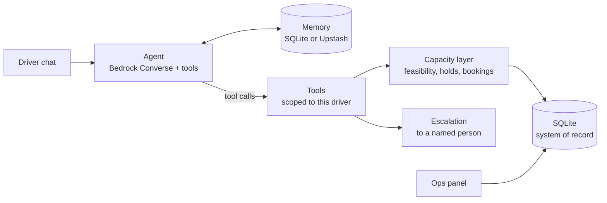

# SetuHaul exception agent

Drivers message SetuHaul when they run late. This service answers them in chat and books a new dock
slot they can actually make, and it stays correct when ten drivers want the same slot at once.

FDE Academy challenge, deliverable 3 (working prototype) and deliverable 5 (integrity proof).

## The one design rule

**The language model talks; code decides.** The model reads messy messages ("late by one hour",
"anything after 7", "the second one, but I must leave by 9"), asks for missing facts and calls tools.
Whether a slot fits, who gets it and what is booked are decided only by `setuhaul/capacity.py`, inside
a database transaction. The model cannot invent availability, because the only way it learns about
slots is a tool result.



| Layer | Does | Never does |
| --- | --- | --- |
| Agent (`agent.py`) | Reads free text, asks only for what the backend lacks, keeps context, explains options | Invents a slot, promises capacity, picks a priority silently |
| Tools (`tools.py`) | Validate input; the driver ID comes from the session, so a driver can only touch their own shipments | Accept a shipment the driver does not own |
| Capacity (`capacity.py`) | Checks dock type, weight, reefer, breakdowns, overruns, unload length, arrival time, driver deadline, last-start rule; holds and books atomically | Trust the seed's `v_slot_availability` view |
| Database | `slot_claims` primary key: one slot, one claim | Allow two holds or bookings on one slot |
| People (`escalation.py`) | Get a complete record for no-slot, priority, approval, safety and data-conflict cases | Get marked "escalated" when nobody could be reached |

## Slot states (brief decision 6)

| State | Meaning | Who moves it | What the driver hears |
| --- | --- | --- | --- |
| Shown | In an options list. Reserves nothing. | `find_slot_options` | "These are free right now." |
| Held | Claimed for 5 minutes. Invisible to other drivers. | `hold_slot` when the driver picks | "I've held D4 12:00 for 5 minutes. Confirm?" |
| Confirmed | Appointment in the system of record. The old booking is cancelled and linked in the same transaction. | `confirm_booking` after a clear yes | "Booked: D4, 12:00 to 13:00." |
| Released / expired | Claim removed. | Driver changes mind, or 5 minutes pass | Nothing, or "That hold ran out; here's what's free now." |

When two drivers pick the same slot, the first `hold_slot` wins. The second gets a refusal with the
reason and fresh options in the same tool result, so the agent can offer alternatives at once.

## Quick start (macOS)

```bash
git clone https://github.com/Ashadeepa/setuhaul-exception-agent
cd setuhaul-exception-agent
python3 -m venv .venv && source .venv/bin/activate
pip install -r requirements-dev.txt
cp .env.example .env          # then fill in BEDROCK_MODEL_ID and AWS_REGION
uvicorn setuhaul.api:app --reload
```

Open http://localhost:8000. Pick a driver, press **New conversation**, and use the sample message
under the input box, or type your own. The right side shows the Jaipur dock board, active holds,
escalations (with an Acknowledge button for operations) and the decision log. The clock starts at
**10:15 on 4 August 2026**; use **+5 min** to make holds expire.

Without `BEDROCK_MODEL_ID` the page still loads. The board, race and escalations work; chat replies
return a clear 503.

### Configure Bedrock

1. In the AWS console, open Amazon Bedrock in the region you will use and make sure a Claude model is
   enabled for your account.
2. Copy its model ID, or its cross-region inference profile ID if your account uses those, into
   `BEDROCK_MODEL_ID`. Set `AWS_REGION` to that region.
3. Credentials come from the normal boto3 chain: `AWS_PROFILE`, `aws sso login`, or environment keys.
   The IAM identity needs `bedrock:InvokeModel` on that model.

The agent uses the Converse API with tool use (`setuhaul/llm.py`). The request shape is checked in
tests against botocore's own Bedrock schema (`tests/test_bedrock_shape.py`).

### Conversation memory: SQLite or Upstash

Memory holds the message history and the driver's confirmed constraints (which shipment, earliest
start, latest finish), so the agent never asks twice. It is context, not truth: slots and bookings
live only in the database.

- Default: SQLite, in the `agent_state` table. No setup.
- Upstash Redis: set `UPSTASH_REDIS_REST_URL` and `UPSTASH_REDIS_REST_TOKEN` in `.env`. The app talks to
  Upstash's REST API with the standard library, and keys expire after 24 hours. The ops panel header
  shows which store is active.

## Tests and the integrity proof

```bash
pytest -q
```

57 tests, no AWS needed (a scripted model stands in for Bedrock):

- `tests/test_integrity.py` (**deliverable 5**). Seven trucks hold and confirm the same slot at the
  same instant, each on its own connection, released by a barrier. Run 20 times: every round has
  exactly one winner, one claim and one active booking. It also covers overlapping two-slot requests,
  the exact race from the brief (both drivers see the slot free, both say "take it"), and the database
  backstop rejecting a second claim directly.
- `tests/test_capacity.py`: each feasibility rule, tied to the data-audit finding it fixes.
- `tests/test_agent.py`: tool scoping, duplicate messages, a model outage, constraint memory,
  escalation routing, and the Upstash client.

The ops panel's **Run race** button runs the same race live against the current data.

## What changed from the seed data, and why

The working database is rebuilt from `data/seed.db` on start (`SETUHAUL_RESET_ON_START=1`) or with
**Reset data**. The findings come from the audit in `docs/data_audit.sql`.

| Audit finding | What the prototype does |
| --- | --- |
| A01, A02: no single snapshot clock; a 12:35 no-show leaks into the morning | Simulated clock starting at 10:15. APT1018's NO_SHOW is undone. ETA rows created after "now" are ignored. |
| B01: revised ETAs labelled ORIGINAL_PLAN/HIGH | Labelled UNRECORDED_REVISION/MEDIUM |
| B02: booking on a vague ETA | `find_slot_options` refuses while the ETA is LOW confidence; the agent must get a specific time first |
| D01, D02: weight limits ignored; loads longer than their slot | Weight checked per dock; long unloads book consecutive slots on one dock |
| D03: missed bookings still held as CONFIRMED | `get_shipment_status` reports whether the current booking is still achievable |
| E01, E02: breakdowns and overruns ignored | Dock events and trucks still unloading block slots |
| F01: historical double booking | `slot_claims` primary key plus transactional re-checks |
| F02, F03: cancel without rebook; no replacement link | Rebooking cancels and creates in one transaction, with `replaced_appointment_id` set |
| G01, G02: failed escalation marked done; vacant contact | Routing skips contacts with no email or a vacant role; an escalation is QUEUED until a person acknowledges it, or FAILED if nobody is reachable |
| G03: retry opened a second thread | Duplicates are caught by external message ID, or the same text from the same driver within 5 minutes, across threads |
| H01: 21:00 last-start rule | Slots starting after 21:00 are returned only as "manual approval" and cannot be held |

## Policy choices (to confirm with SetuHaul)

- **Priority:** first valid hold wins. CRITICAL and HIGH loads never displace other bookings
  automatically; if one would wait more than 60 minutes, the tool flags it and the agent offers to
  escalate.
- **Early trucks** do not jump the queue.
- **Reefer and heavy docks** are kept for loads that need them; standard loads are not offered them.
- **Hold length:** 5 minutes.
- **Arrival buffer:** 15 minutes from ETA to dock for trucks on the road, 5 minutes for trucks in the yard.
- **Auto-confirm:** a rebooking into free, feasible capacity is confirmed at once, and the warehouse
  coordinator gets an internal notice. Anything needing approval goes to a person.

## Project layout

```
setuhaul/
  capacity.py    feasibility, holds, bookings (the decisions)
  tools.py       the 9 tools the agent can call, with Bedrock schemas
  agent.py       Converse tool-use loop, dedupe, memory, thread handling
  llm.py         Bedrock client; ScriptedModel for tests
  memory.py      SQLite and Upstash memory stores
  escalation.py  routing and hand-off records
  db.py          working database setup and seed repairs
  clock.py       simulated clock
  api.py         FastAPI app
  static/        one-page chat and ops panel
data/seed.db     the snapshot from the data package
docs/            data audit queries, constraint probe, database guide
tests/
```

## Library versions

Python 3.11 or newer (developed on 3.13). Pinned in `requirements.txt` and `requirements-dev.txt`:

| Library | Version |
| --- | --- |
| fastapi | 0.163.1 |
| uvicorn | 0.54.0 |
| boto3 | 1.44.3 |
| pydantic | 2.13.5 |
| pytest (dev) | 9.1.1 |
| httpx (dev) | 0.28.1 |

## Known limits

- SQLite serialises writes. That is fine at SetuHaul's scale (20 to 35 messages in a 30-minute spike);
  a multi-facility deployment would move `slot_claims` to Postgres, keeping the same primary-key guarantee.
- Escalation delivery is simulated: a record is queued for a named contact and shown in the ops panel.
  Nothing is emailed.
- Gurugram has slots but almost no shipments, so it is only checked for staying separate from Jaipur.
- The optional facility-level scheduling tool is not built yet.
